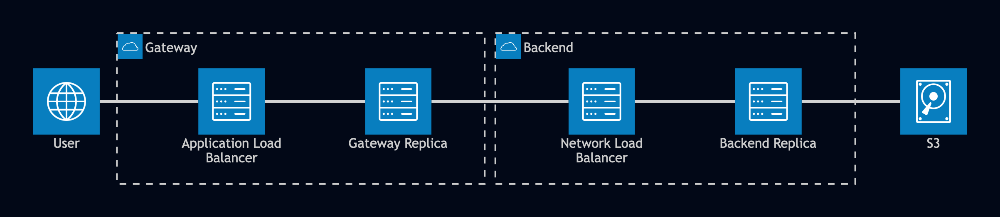

File Transfer Service
===========

## Architecture

The file transfer service consists of two parts: a gateway and a backend.

The **gateway** is where client requests come in and is broken into two parts:
- `transfer-client` which handles sending and receving messages on UDP according to the [FTP_6650 Protocol](FTP_6650-protocol-README.md)
- `transfer-frontend` which handles HTTP requests for the files, delegating to the `transfer-client` to retrieve those files

The **backend** is what handles sending files over and is one large server:
- `transfer-server` handles sending and receving messages on UDP acoording to the [FTP_6650 Protocol](FTP_6650-protocol-README.md). It also handles getting the original file from its source location, whether that be local or on Amazon S3.

The gateway and backend communicate via a custom protocol sent over UDP. **You don't need to read or understand the protocol to use the service!** You do need to udnerstand it if you want to perform additional logging. You will find the protocol's description in [FTP_6650-protocol-README.md](FTP_6650-protocol-README.md).

Note that the protocol works with _any_ file format since all files are bits in the end. Text files are easiest to use if you want to make sure everything is working properly though.

## API Endpoints

The gateway exposes two endpoints, also described in [gateway_api.yaml]:
- `GET /files?name=<FILE-NAME>` : Retrieve a file with the given name. Can return the following status codes
    - `200 OK` with the file in the body as bytes
    - `404 file not found` if the file does not exist
    - `503 the file server rejected the request` if the file server rejects the request outright
    - `504 the file server did not respond` if the file server was reached but never responded
- `GET /health` : Ask for a health check. Can return the following status codes
    - `200 OK` for healthy
    - `503 draining` for unhealthy and shutting down

The backend only has one API endpoint:
- `GET /health` : Ask for a health check. Can return the following status codes
    - `200 OK` for healthy
    - `503 draining` for unhealthy and shutting down

The backend otherwise responds to UDP datagrams that follow the [FTP_6650 Protocol](FTP_6650-protocol-README.md).

## Graceful termination

The gateway and backend allow for graceful if interrupted or killed. Any interrupt or kill signal sent (via Ctrl+C or the `kill` command) will tell that program to refuse new requests and let the currently working requests attempt to finish their work before terminating. Use `kill -9` if you want to kill a process that has the drain flag set.

## Local Setup

You can run the gateway and backend using locally stored files for testing your experiments locally without using AWS resources. The backend can take a `-files` flag to specify the path where the files live.

A bare minium deployment follows, where `<PATH-TO-FILES>` is the path to the folder where the files you want to transfer are:

```bash
go build -o bin/backend ./transfer-server
go build -o bin/gateway ./transfer-frontend
bin/backend udp -dir=<PATH-TO-FILES> -port=8080 -health-port=8081 &
bin/gateway -transport=udp -upstream=localhost:8080 -listen=:8082 &
```

You can then send requests to the gateway via `curl`

``` bash
echo "hello there" > <PATH-TO-FILES>/my-file.txt
curl -o out.txt "http://localhost:8080/files?name=my-file.txt"
cat out.txt   # Should see "hello there"
```

## AWS Architecture

The AWS architecture is shown below (image created using [mermaid.live](https://mermaid.live))



The gateway is hidden behind an Application Load Balancer and is hooked up to an autoscaler, hence the replica. The backend is hidden behind a Network Load Balancer and is hooked up to an autoscaler, hence the replica. A **network load balancer** does the same job as the application load balancer, but it traffics TCP packets and UDP datagrams instead of HTTP requests. In other words, it is a load balancer at the transport level of the OSI model.

The backend gathers files from S3 instead of local disk. This allows the backend to be truly stateless and therefore replicatable.

## AWS Deployment

See [AUTO_SETUP.md](AUTO_SETUP.md) for all the details on how to set up and deploy the service on AWS using the scripts given. The process is involved. Windows users should have Git Bash to assist with running the bash scripts for deployment or use the manual setups in [MANUAL_SETUP.md](MANUAL_SETUP.md)

## AWS Tear down

Step 8 in [AUTO_SETUP.md](AUTO_SETUP.md) describes how to use the scripts to automatically tear down the service. The only manual part is deleting the S3 bucket which that step also details. Windows users will need to use Git Bash to run the bash script or follow Step 14 in the [MANUAL_SETUP.md](MANUAL_SETUP.md) to tear everything down manually.

## AI Usage Disclosure

The server and client were written by hand, but the gateway wraparound and concurrent additions were generated by Claude Code in plan and manual mode as an experiment with using Claude Code to handle wrapping a local service into a web-ready service. The decisions made were authorized and inspected by the author manually as they were proposed and edited, resulting in an overly customizable gateway and backend. This does not absolve the author of errors, mistakes, or confusion caused.
